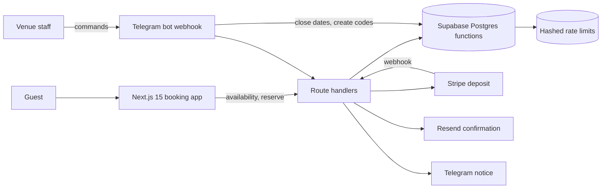

# Restaurant Reservation Platform

A white-label reservation product for restaurants: guests book a table online and pay a deposit, while the venue runs day-to-day operations from a Telegram bot. Everything venue-specific lives in configuration, so the same codebase can be re-skinned for another restaurant.

> The source code is private. The first deployment was for a client who is anonymized here. All example data is fictional.

## The problem

Restaurants take reservations by phone and messaging apps, lose track of no-shows and have no easy way to block dates or offer courtesy codes to friends and family.

## What it includes

- **Booking flow:** date, party size and time slot with real-time availability computed in SQL, guest details, review step and confirmation email.
- **Deposits:** Stripe payment with webhook confirmation and cancellation handling.
- **Telegram control bot:** the venue sees every new reservation and runs commands for today's and tomorrow's bookings, closing and reopening dates and managing codes. A private activation link links the chat to the venue.
- **Courtesy and group codes:** the venue creates codes from Telegram (validity window, discount, usage cap, note). A valid code books without a deposit and is re-checked atomically when the reservation is created.
- **Abuse protection:** rate limiting where IPs and emails are hashed with a salt before storage.
- **Guest tickets and feedback:** a ticket page per reservation and a feedback endpoint, plus a no-show email flow.
- **White-label configuration:** brand, copy, tables and commands live in `src/config`.

## Architecture

## Tech stack

- **Next.js 15**, **React 19**, **TypeScript**, **Tailwind CSS 4**
- **Supabase** (Postgres with SQL functions for availability and reservations, and explicit function grants)
- **Stripe** (deposits and webhooks), **Resend** (email), **Telegram Bot API**
- **Zod** validation and **Playwright** for visual audits
- **Vercel**

## Highlights

- **Business logic in the database:** availability, reservations, rate limits and promo codes are SQL functions with explicit grants, covered by SQL tests.
- **Operations from a chat app:** the owner needs no admin dashboard.
- **Idempotent and atomic:** a code or a deposit cannot be consumed twice.
- **Reusable:** designed as a build-once, resell-many template.

[Back to profile](https://github.com/Ernesto-9)

See more projects on my [GitHub profile](https://github.com/Ernesto-9).
